# OC Manager

> OpenCode 全能工作台——让 AI 编程更优雅

<p align="center">
  
  
  
  
  
</p>

**OC Manager** 把 OpenCode 的命令行操作收进一个顺手的桌面窗口：启动服务、管理会话、浏览项目、编辑配置，一站完成。支持 OpenCode **v1 与 v2**。

<p align="center">
  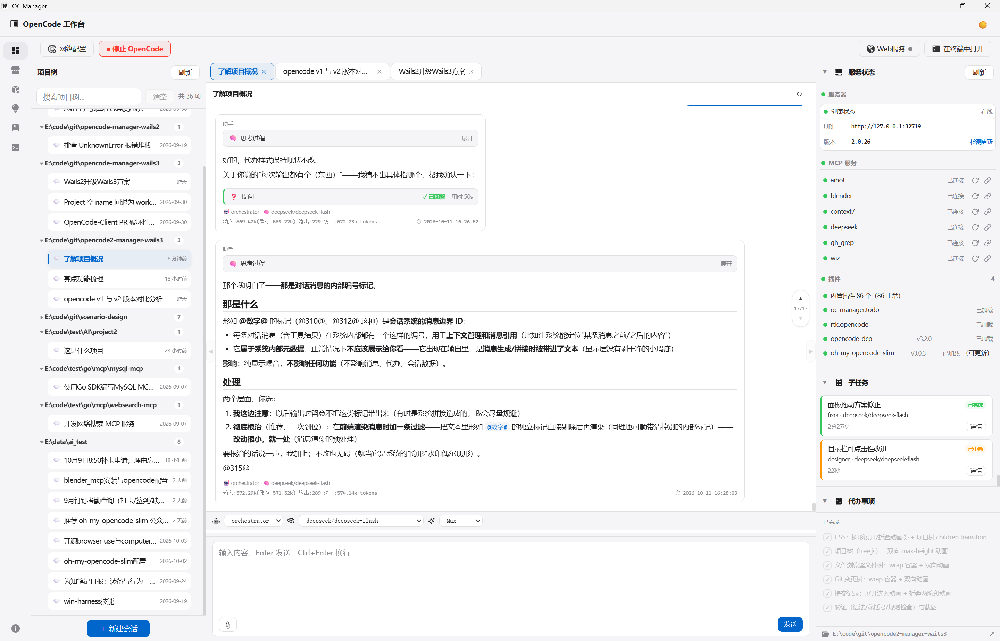
</p>

---

## 它能做什么

### 一个窗口，理清整个工作流

- 左侧项目树、中间对话区、右侧信息面板，三栏布局一目了然
- 启动服务、切换会话、浏览项目与文件，都在同一个窗口完成
- 桌面端多会话 Tab 并行，各自独立滚动与渲染，切换零卡顿，关闭即释放

### 对话清爽，重点不淹没

- 用户与 AI 消息分列排版
- 推理过程、工具调用、文件操作默认折叠，想看再展开
- Markdown 完整渲染，代码块语法高亮
- 子任务与代办事项自动从会话中提取并集中呈现
- 命令面板支持 `/` 键唤起

### 文件与 Git，一站直达

- 懒加载文件树，文本、代码、Markdown、HTML、图片、PDF 均可预览
- 文件可编辑、上传、删除
- 可在独立窗口打开，专注浏览
- 变更以左右对照 diff 呈现，右侧可编辑保存
- Git 面板支持查看变更、暂存提交、推送拉取，可走代理连接

### 配置与技能，集中管理

- OMO 模型映射按 agent / category 粒度配置
- 方案导出、导入、入库、应用一步到位
- 供应商模型列表一键拉取
- 项目级配置：直接管理 `.opencode/` 下的核心配置、技能、命令、规则与 `AGENTS.md`
- 技能管理：全局聚合扫描、冲突检测、一键启停、软链接导入

### 知识库，沉淀即资产

- 把想法、操作步骤、提示词、项目信息沉淀为条目
- 分类树与标签组织，Markdown 编辑实时预览
- 对话中输入 `@` 即可引用，作为独立上下文交给 AI
- 条目可一键转化为技能、命令、规则或项目准则，写入前预览确认

### 桌面级细节

- 系统托盘常驻，点按切换显示 / 隐藏
- `Shift+X` 随时呼出主界面
- 二次启动自动激活已有窗口，不重复开进程
- 通过 SSE 实时推送服务状态，一键检查 OpenCode 新版本
- 深色主题、网络代理、可视化目录选择器

---

## 三端可用

| 平台 | 说明 |
|---|---|
| **桌面端** | Wails / WebView2 原生窗口，多会话 Tab、系统托盘、全局快捷键 |
| **Web 端** | 内置 HTTP 服务，浏览器直接访问同一套界面 |
| **手机端** | 自适应布局，单会话模式，随时查看与追问 |

一套代码，随处可用。

---

## 绿色便携

OC Manager 是**绿色便携**应用：程序目录自带一切，拷走即用，不写系统目录。

```
<程序目录>/
  oc-manager.exe          # 主程序
  tools/opencode.exe      # 自带的 opencode —— 优先使用，无需系统安装
  agentdatas/             # 便携数据（opencode 与 OC Manager 共用）
    config/opencode/      # 配置：opencode.jsonc、OMO 方案、service.json
    data/opencode/        # 数据：会话、凭据
    cache/opencode/       # 缓存（可再生）
    state/opencode/       # 状态：服务注册 service.json
    runtime/              # 运行时目录（Linux）
  configs/                # 内置配置模板
  vault/                  # 知识库数据（独立于 OpenCode）
  log/                    # 运行日志
```

- **自带 opencode**——启动服务时优先使用 `tools/opencode.exe`，不依赖系统 `PATH`，系统未安装 opencode 也能正常运行。
- **免安装 / 整体搬迁**——整个目录拷到任意路径或另一台机器即可运行，配置、会话、知识库全在目录内，不污染 `~/.config`、`~/.local`。
- **便携数据目录**——程序启动最早期通过 5 个 XDG 环境变量，把 opencode 的配置 / 数据 / 缓存 / 状态指向程序目录下的 `agentdatas/`。
- **启动拦截**——启动服务前检测系统中是否已有 opencode 服务在运行（外部启动或上次残留），命中则拒绝启动，避免两套服务并存。

### 获取 opencode

OC Manager 与 opencode **v1、v2** 均可配合使用：

- **v1**——GitHub 发布页下载：[anomalyco/opencode releases](https://github.com/anomalyco/opencode/releases)
- **v2**——按版本号下载https://opencode.ai/files/bin/{版本号}/{软件版本}，例如 `2.0.26`、`windows版本`：
  `https://opencode.ai/files/bin/2.0.26/opencode-windows-x64.zip`

### 迁移到便携版

若此前使用系统安装的 opencode，可按下列步骤迁入便携目录：

1. 把 opencode 可执行文件放到 `<程序目录>/tools/opencode.exe`
2. 旧配置 → `<程序目录>/agentdatas/config/opencode/`（`opencode.jsonc`、OMO 方案、`skills/`、`commands/`、`rules/`）
3. 旧数据 / 凭据（通常 `~/.local/share/opencode`）→ `<程序目录>/agentdatas/data/opencode/`
4. `vault/` 放到程序目录（与 `configs/` 同级）
5. 启动 OC Manager 验证：工作区能连接、供应商 / OMO / 技能正常加载、历史会话可见

> 详细说明见 [doc/使用说明.md](doc/使用说明.md) 第 10 章「绿色便携与迁移」。

---

## 截图

<details open>
<summary><b>工作区</b></summary>
<p align="center">
  
  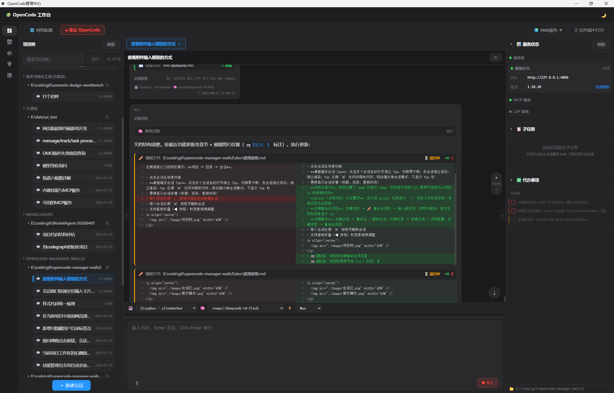
</p>
</details>

<details>
<summary><b>会话区 · 文件树 · Markdown 输出</b></summary>
<p align="center">
  
  
  
  
</p>
</details>

<details>
<summary><b>配置管理</b></summary>
<p align="center">
  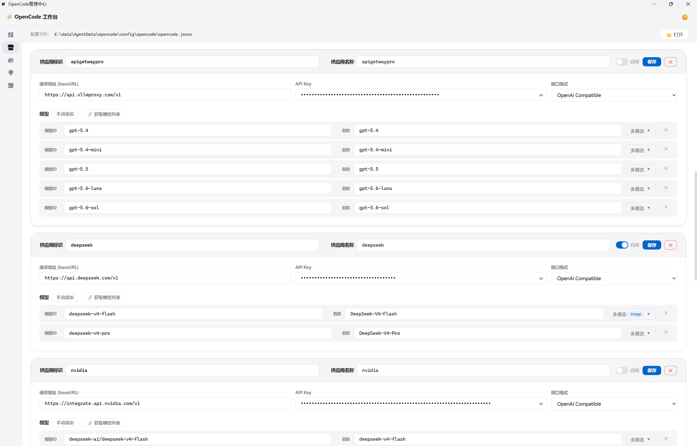
  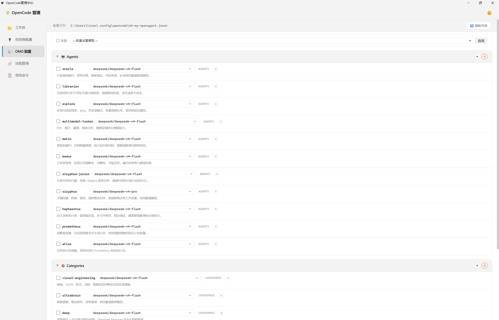
  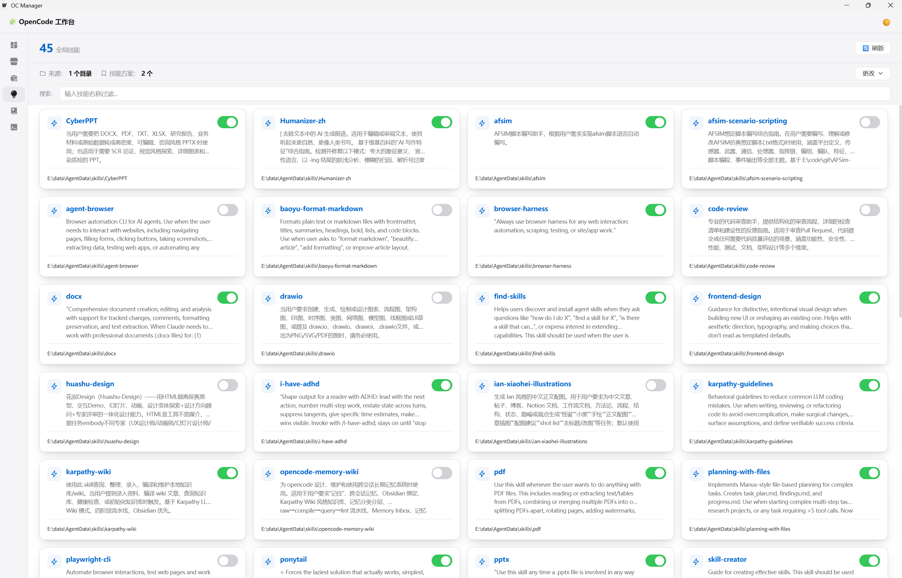
  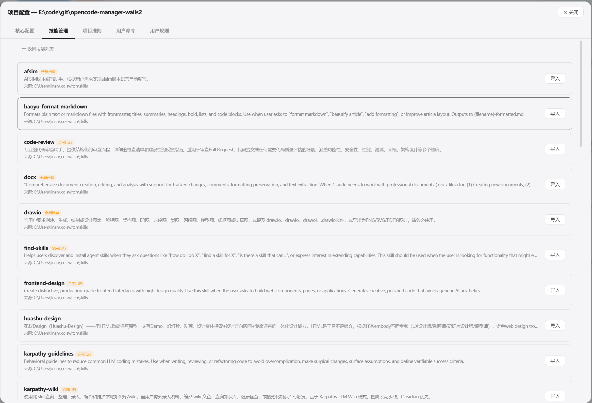
</p>
</details>

<details>
<summary><b>文件管理</b></summary>
<p align="center">
  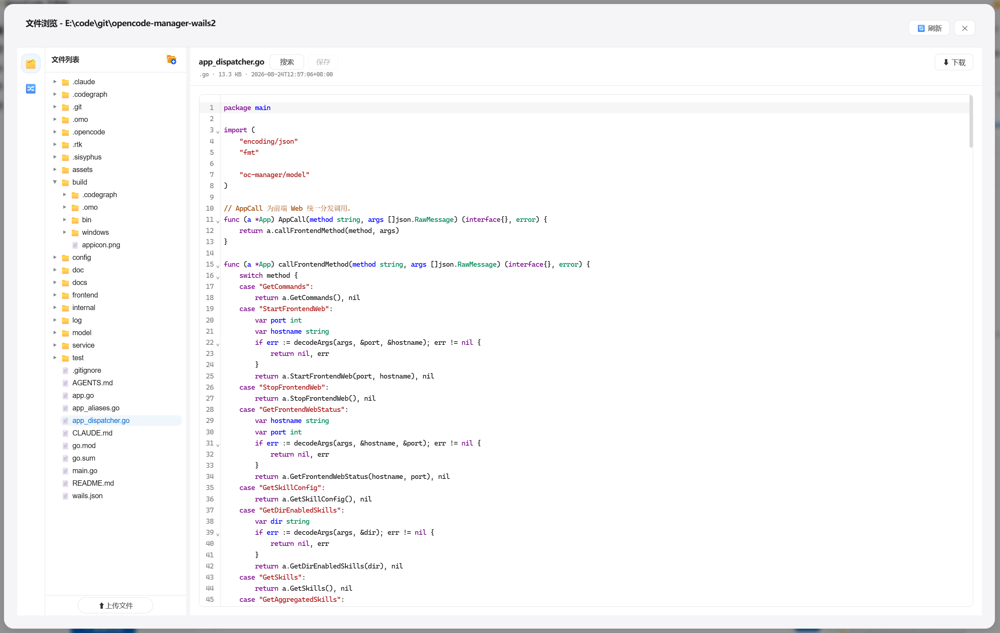
  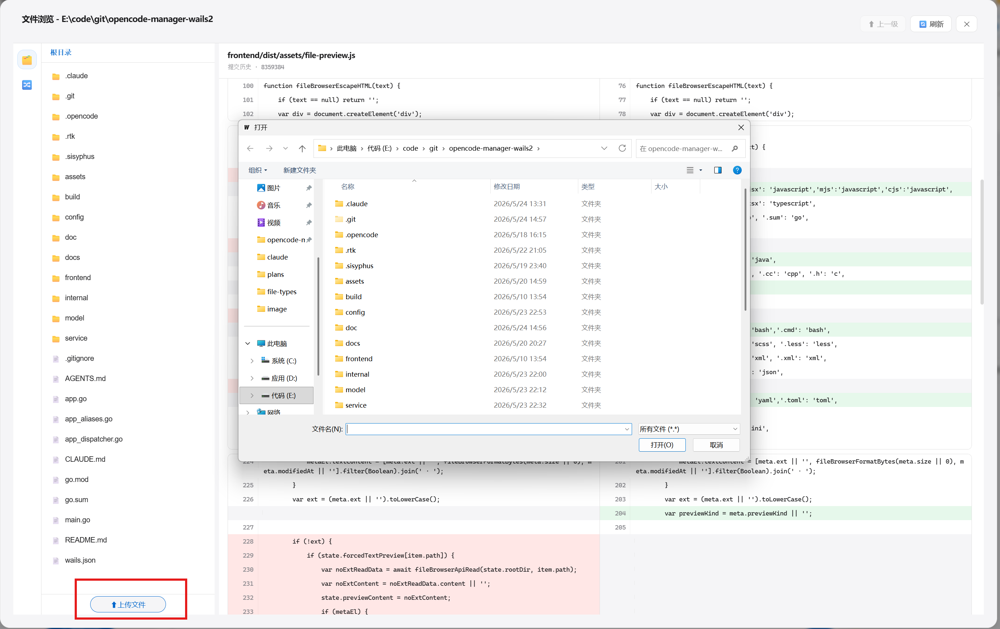
  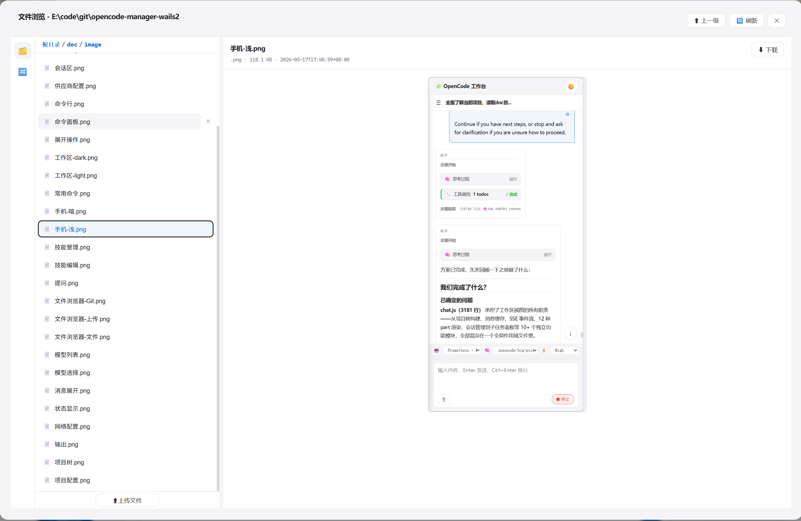
  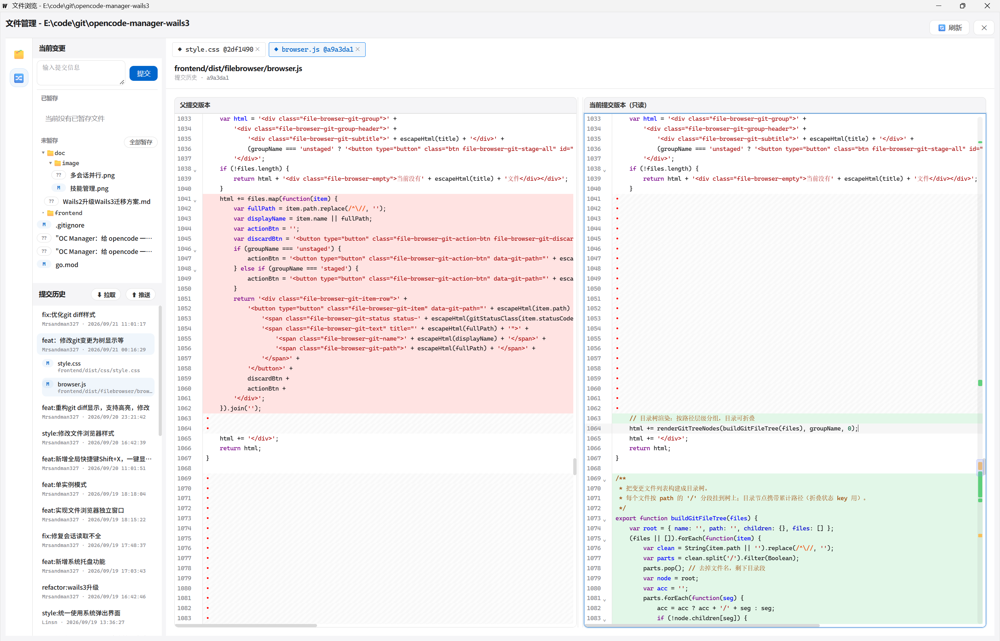
</p>
</details>

<details>
<summary><b>知识库</b></summary>
<p align="center">
  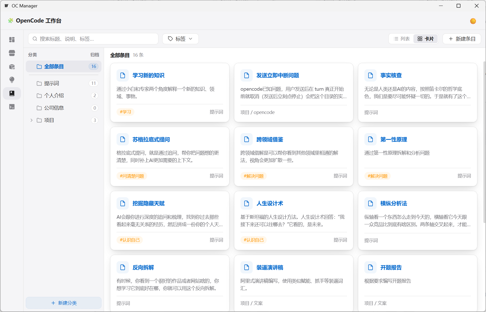
  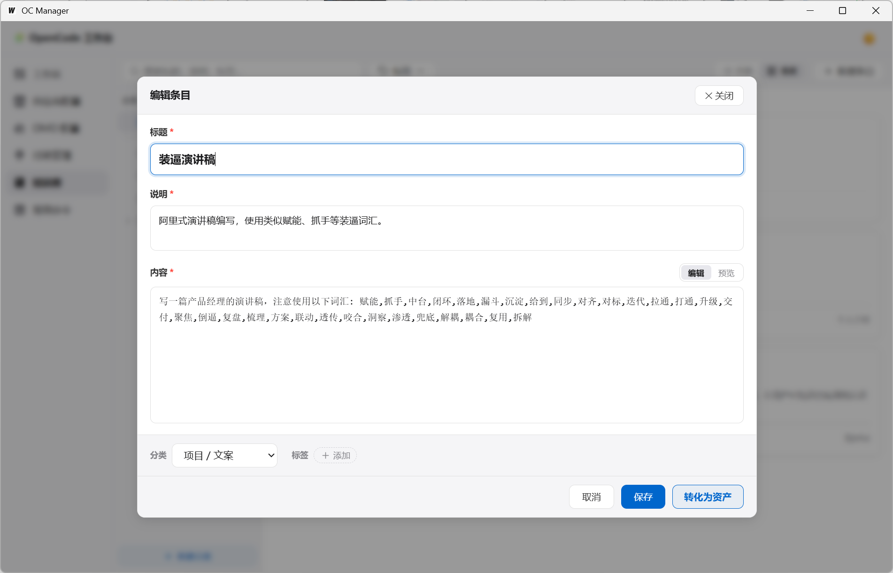
  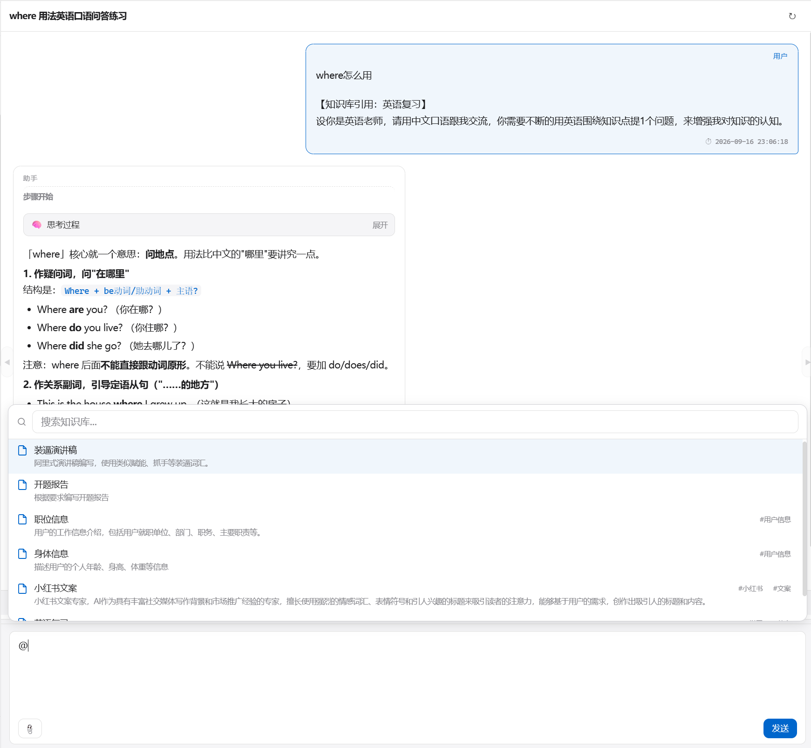
  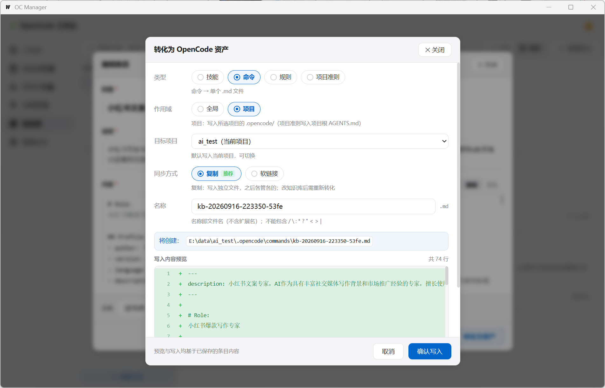
</p>
</details>

<details>
<summary><b>三端 · Web / 手机</b></summary>
<p align="center">
  
  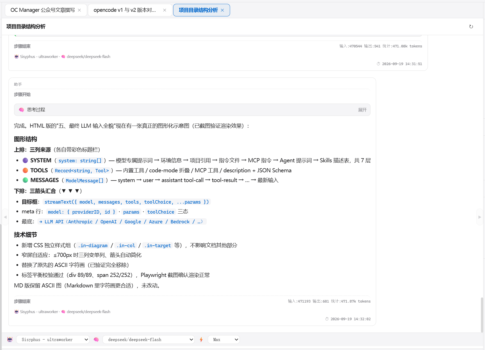
  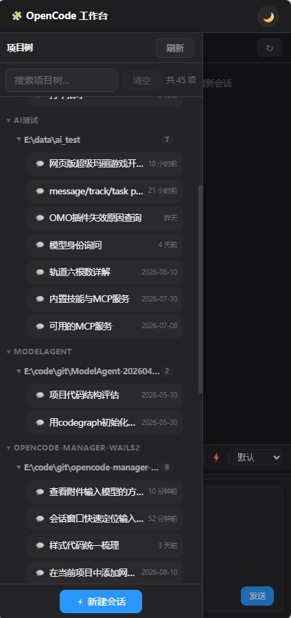
  
</p>
</details>

---

## 构建

```bash
wails3 dev          # 开发模式（热重载）
wails3 build        # 生产构建 → bin/oc-manager(.exe)
go build .          # 仅编译 Go 后端（构建走 wails3；build/ 下为 wails 模板，故勿用 ./...）
go vet ./internal/... ./model/... ./service/... ./config/...   # 静态检查（同上，避开 build/ 模板）
```

> **前置条件**：Go 1.25+ · wails3 CLI · Windows WebView2 / Linux WebKitGTK（`sudo apt install libgtk-3-dev libwebkit2gtk-4.0-dev pkg-config gcc`）

---

## 使用指南

详细操作手册见 **[doc/使用说明.md](doc/使用说明.md)**

---

<p align="center">
  <sub>Made with ❤️ for the OpenCode community</sub>
</p>
